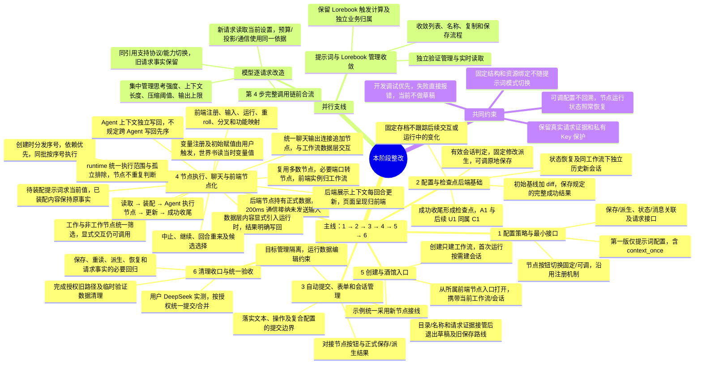

# 当前进度与实现顺序调整

记录日期：2026-10-11。核对对象：`develop` 当前未提交工作树。

## 0. 当前规划入口

2026-10-12 用户已批准 39，当前工作规划唯一入口为 [40：统一工作规划与实施顺序](40-统一工作规划与实施顺序-2026-10-12.md)。本次四并发只统一文档，产品实施继续暂停。

本页下列进度、源码行号、验证数量、旧“下一步”及第 6 节规划树保留为原调整和基线历史，不再独立维护当前顺序。原树已由 17 确立基线，链接和原身份保留；冲突的历史闭包/membership、来源证明、独立 once 台账、工作流二次限额和静默派生要求均已由 40 取消或订正。

当前依赖仍为最小契约订正 -> 检查点完整保存/恢复/整份历史复制 -> 页面自动提交与确认后派生 -> D 最终执行/聊天/模型合流 -> E 创建/酒馆 -> 清理和统一验收。具体未定字段和 D/E 用户流程仍须审阅，已定行为及三默认值不重新讨论。

用户要求整理当前进度，并根据新增规则调整实现顺序。本轮只核对代码、既有验证证据和规划，不修改产品代码，不执行数据清理、产品测试、服务或真实模型调用，不提交、推送或合并。

设计规则见 [06：核心规则](06-工作流核心与修改规则-2026-10-11.md)、[12：模型实时契约](12-模型实时读取契约论证-2026-10-11.md)、[13：资源与检查点策略](13-资源收敛与检查点配置策略-2026-10-11.md)。首批实际实施及完整验证范围见 [11：实施记录](11-首批整改实施与离线验证-2026-10-11.md)。本页更新后续顺序，不倒改首批成果。

后续规划补充：用户已明确当前不做草稿，保存失败直接报错，独立草稿机制列为第 3 步退出项。草稿归属及会话草稿隔离从第 1 步契约和验收目标撤掉；普通内存表单直接提交，目录和名称等管理数据、未决请求原始证据先由对应责任模块接管。本文登记不执行代码或数据清理。

2026-10-12 用户进一步确定的规则见 [16：检查点、装配与前端节点化](16-检查点装配边界与前端节点化决定-2026-10-12.md)：成功回合结束的检查点与消息归属、提示词装配求值、模型四项参数和同引用协议/能力切换、工作流前端节点实例及创建序号。主顺序不变；第 1 项改为据此交付具体接口，第 4 项明确前端节点化，第 5 项待节点化后整合，不重新提出同一组方向选择。

2026-10-12 第一阶段入口补充：用户指定固定/可调使用节点上的按钮切换，按节点注册机制接入。第 1 步形成按钮声明和策略接口，后续保存链路消费同一节点策略；本阶段整体规划树见第 6 节。此处记录计划，不将按钮或后端接口登记为已实现。

本阶段规划树随后已由用户确认并要求提交、确立基线，记录见 [17：阶段规划确认与实施基线](17-阶段规划确认与实施基线-2026-10-12.md)。整体范围和顺序不再待选；实际接口、节点和接线在对应阶段给出，不将规划提交当作产品实现完成。

2026-10-12 后续第 4/5 步的节点规则进一步订正，见 [28：节点交互与运行调度](28-节点交互与运行调度规则订正-2026-10-12.md)：变量注册/初始赋值为主动交互，runtime 统一排除孤立节点，世界书读当时变量值，统一聊天输出接追加节点，独立 Agent 上下文按 runtime 调度写回。替代自动初始化及旧示例固定写回先序；主线依赖和具体审阅关口保持，未启动产品实现。

架构职责与交互数据补充见 [29](29-工作流架构职责与交互数据边界-2026-10-12.md)：Agent 内核归节点内部，页面展示归前端，工作流只提供交互能力；后端节点维护正式输入及展示上下文，200ms 通信成功后未发送输入也成为节点数据。上下文/变量显式进入运行时，runtime 统一筛选工作/非工作节点。成功检查点仅保存规定结果和固定恢复起点，当前交互及未完成进度单独维护。主线顺序不变。

2026-10-12 上一批审阅见 [33：历史恢复与 D 联合审阅](33-历史恢复与D接线实施前联合审阅-2026-10-12.md)：30的历史闭包权限、31的检查点/唯一Head/恢复事务及32的节点接线形成待审；该批没有产品或测试改动。

最新推进见 [37：Key接管与D精确契约合流](37-Key证据接管与D精确契约合流实施记录-2026-10-12.md)：34/35补齐PROMPT3/7来源证明和runtime精确声明，仍未安装；36已实际接管Key非秘密请求证据，相关后端233、前端全量1374及构建通过，测试库已回收。旧unknown只读门禁和其他draft消费者保留。第2步生产恢复、第3步普通页面自动提交和D/E安装仍未完成；不重谈已定行为/defaults。下文2026-10-11调查保留为历史，不把24-27及37已交付基础再记为未实施。

最新继续实施见 [38：历史读取与检查点恢复数据层基础](38-历史读取与检查点恢复数据层基础实施记录-2026-10-12.md)：第2步的内部checkpoint/Head仓储、正式根历史权限、完整executor/M2更新证明和逻辑对象恢复已有未安装代码，真实SQLite合流验证CAS、回滚、配置和原事实隔离。完整生产恢复、新历史会话命令、native深层lineage、最终输入/闭合声明及D/E仍待接入，不把本批内部基础当作第2步整体完成；默认storage19不变。

## 1. 当前做到哪里

总体状态：首批完成了若干基础职责拆分和生命周期操作，但没有任何 A-E 整批可登记为完成。新讨论中的可调提示词、统一运行状态快照及 diff、取消节点数据修订号，均仍为设计方向。

| 范围 | 当前已有成果 | 仍未完成 |
| --- | --- | --- |
| A：工作流与会话管理 | 后端目录、目标归档删除、停止所属运行、归档只读、目标数据与全局资源隔离、未核实请求保护 | 历史新会话的独立所有权、旧跨流复制与改绑退出，以及与新检查点规则衔接 |
| B：配置及内容所有权 | 配置/内容管理不先启动图宿主；内容服务脱离供应商；前端薄侧栏分别承载业务组件；P01 专属 Key 补绑定退出 | 完整管理隔离、资源管理重复流程及名称/复制体验收敛 |
| B：全局正文读取 | 提示词、Lorebook 后续读取当前保存正文，已完成输出保持原事实 | 此成果不包括模型参数、容量和 Key 的逐请求实时读取 |
| B/D：模型配置生效 | 现有模型授权、请求事实、结果接纳和未知请求保护可复用 | 仍为整轮模型配置和凭据租约；12 的逐请求配置、预算与事实契约尚未实施 |
| C：编辑与保存 | 保存退出通用宿主/可运行性门禁；目标写入核对；运行中禁止手动数据写入；部分管理不再保存所有业务表单 | 有效会话判定与定义派生、可调提示词例外、自动后端提交、普通内存表单直接生效、独立草稿机制退出和数据编辑告知 |
| D：检查点与上下文 | 已有节点私有状态、变量/对象历史、候选恢复、上下文装配/合并及 context_once 消费记录 | 尚未取消节点数据修订号，尚未统一为基线加 diff；恢复仍采用历史定义，没有可调配置排除回溯 |
| D：节点执行与聊天 | 已有节点注册、编译、执行及扩展宿主，读取/装配/调用/更新能力有现存实现 | 本轮目标中的激活、同批节点序号、先序精简、聊天职责及失败操作尚未完成整改；具体方案仍需人工确认 |
| E：创建与酒馆入口 | 已有示例、聊天展示入口及会话操作，可作后续基础 | 尚未完成新架构下创建、自动提交、首次运行和入口一体化整改及人工验收 |
| 清理与交付 | 11 记录了选定开发产品库重置、普通旧归档删除和请求证据分离 | 浏览器旧存储清理、已登记临时验证目录删除仍未完成；真实验收、产品提交与 main 合并未进行 |

本轮未重新读取产品库核实其当前行数；关于实际重置和清理结果采用 11 的阶段记录，不将历史清理回执当成产品库此刻仍为空的证明。

## 2. 源码与验证依据

当前关键代码印证了上述未完成边界：

- [workflow_lifecycle.py](../../../../backend/src/phase1_agent/workflow_lifecycle.py#L151) 已有对象范围内的归档删除；历史被其他会话引用时仍存在 `session_history_in_use` 约束，独立历史新会话尚未收敛。
- [content_configuration.py](../../../../backend/src/phase1_agent/content_configuration.py#L34) 已提供独立内容 CRUD；[graph_resource_host.py](../../../../backend/src/phase1_agent/graph_resource_host.py#L103) 对提示词/Lorebook 读取当前保存值。
- [model_service.py](../../../../backend/src/phase1_agent/model_service.py#L179) 仍在运行准备时捕获配置与凭据租约，后续参数和容量取自 `frame.config`；管理独立不能证明模型实时契约完成。
- [workflowEditing.ts](../../../../frontend/src/application/workflowEditing.ts#L20) 编辑仍接受工作流草稿并持久化工作台；[workflowManagement.ts](../../../../frontend/src/application/workflowManagement.ts#L54) 仍分别维护 publish、save、bind；启动仍检查定义修订匹配。
- [graph_service.py](../../../../backend/src/phase1_agent/graph_service.py#L235) 保存仍生成定义修订和配置绑定，尚未按有效会话与可调策略实施新的派生规则。
- [PromptGroupFields.vue](../../../../frontend/src/components/PromptGroupFields.vue#L16) 的草稿依据仍含 SDK 生命周期，应用仍调用所有表单的 `flushAll`；部分管理隔离不代表这条链路已精简。
- [graph_service.py](../../../../backend/src/phase1_agent/graph_service.py#L306) 节点私有数据仍递增 `data_version`，[检查点提交](../../../../backend/src/phase1_agent/graph_service.py#L336) 仍保存正文与变量/对象历史引用，[graph_candidates.py](../../../../backend/src/phase1_agent/graph_candidates.py#L160) 候选恢复仍会采用历史定义。
- [context_prompt_v6.py](../../../../backend/src/phase1_agent/context_prompt_v6.py#L69) 与 [context_v4.py](../../../../backend/src/phase1_agent/context_v4.py#L186) 已有 once 消费机制；这部分是可复用基础，不必因配置策略调整重建一套去重规则。

11 记录首批最终后端 27 文件集成 377 通过、前端 92 文件 1177 项通过，以及类型检查、构建和离线浏览器验证通过。本轮只读确认 `.local/maintenance/midterm-final-integration-20261011.xml` 存在，报告为 377 tests、0 errors、0 failures、0 skipped；未重新运行。

这些证据验证首批实际改动，不证明 12/13 新设计已通过，不代表后端全量、真实产品页面、真实模型或新检查点方案验收。已有测试定义与执行报告分别对待。

## 3. 为什么调整顺序

原 A -> B -> C -> D -> E 的顺序适合职责拆分初期。现在 C 的派生和自动保存需要判断哪些配置固定、哪些可调；A 的历史新会话需要新的检查点归属；B 的模型实时读取又依赖 D 的请求预算和事实契约。若先完成旧修订/重绑路线上的自动保存，再处理这些规则，会再次修改保存和恢复接口。

因此前移的是 D 中的配置、状态和请求契约论证及必要基础，不是提前启动全部节点重写或酒馆流程。A-E 保留为范围分组，不再当成必须整批完成后才能进入下一批的串行顺序。

## 4. 调整后的推进顺序

| 顺序 | 交付 | 依赖与边界 |
| --- | --- | --- |
| 1 | 形成已定规则对应的配置、状态与请求接口 | 固定/可调通过节点上的按钮切换，按节点注册机制给出声明及策略接口；根据 12/13/16 给出保存/派生、状态/消息关联和请求设置的最小格式，具体节点/调度契约按实际改动审阅 |
| 2 | 落实配置与检查点后端基础 | 固定定义及可调提示词当前值、有效会话判定、编辑分类/派生接口、统一逻辑运行状态、取消节点数据修订号、基线与 diff、恢复及独立历史新会话。固定配置、运行状态和执行事实各有明确归属 |
| 3 | 接入自动提交、表单及会话管理，退出草稿机制 | 依赖第 2 项契约，完成原地修改/派生、可调提示词保存、普通内存表单直接提交且失败报错、会话切换、数据编辑告知和目标管理隔离；管理数据与未决请求证据接管后删除独立草稿，退出旧应用/保存/跨流改绑与复制路线 |
| 4 | 完成节点执行、聊天数据流和运行前端节点化 | 按 28/29 复用节点，盘点前端注册、输入、运行开关、重 roll、分叉和功能映射；实例及正式数据归所属工作流/会话节点，页面展示归前端。落实工作/非工作筛选、显式数据读取、Agent 节点内部执行、写回及固定成功存档 |
| 5 | 在前端节点化后整合创建、首次运行与酒馆入口 | 复用第 3/4 项的节点实例和接口，完成按需建会话与一致操作流程，具体流程确认后实施并人工验收 |
| 6 | 清理收口、跨模块验证与统一验收 | 汇总普通旧存储及临时验证数据实际清理结果，验证保存/重读/恢复/分叉与真实请求事实；最后由用户进行 DeepSeek 实测，完成后按授权统一提交/合并 |

第 2 项内部先确定并实现完整逻辑状态的保存/恢复，再在同一交付中落实 diff。diff 是物理存储实现，不另建一套并行生效架构，也不先扩展压缩链、缓存或性能平台。仅讨论清楚“节点数据修订号取消”不能代替状态格式、删除项和分支恢复设计。

第 3 项开始不必等待模型通信支线全部完成，但运行与最终集成须使用已确认的新请求契约，不能再次按旧整轮帧制作调用事实。

第 3 项的草稿退出覆盖工作台、节点、供应商、全局提示词、Lorebook 和会话输入的持久保存、自动恢复、依据冲突、冲突副本与全体草稿保存门禁。当前目录和名称等正式管理数据接回对应后端接口，未决请求原始证据独立保留用于排查与核实；消费者退出后删除草稿接口、表和专属旧测试。04 等说明只作标明失效的历史参考，不接回执行路径，不建设替代草稿或通用恢复体系。范围见 09/R07，本次未实施删除。

上述退出针对独立草稿路径，不删除 29 确定的正式输入节点数据：用户未发送的内容经 200ms 通信被后端接纳后即已保存，页面重读所属节点；尚未进入后端的部分保持临时内存。成功检查点不承担这类交互数据的持续保存。

### 可并行支线

契约确认后适合三路分工：

| 路线 | 范围 | 合流点 |
| --- | --- | --- |
| 工作流主线 | 第 2 项配置/检查点基础，再接第 3 项自动提交和会话管理 | 为历史、编辑与执行提供同一套接口 |
| 模型请求支线 | 12 的实时配置、普通/压缩预算、凭据及逐请求事实 | 第 4 项完整调用数据流前合流；已接纳请求仍处理原事实 |
| 内容管理支线 | 提示词/Lorebook 控制器收敛、名称和复制体验、保存流程精简 | 独立验证管理和读取；不等待节点顺序整改，不改变 Lorebook 触发用途 |

同一后端状态模块的格式变更与同一前端保存模块的适配不盲目并行；先交付接口再接消费者。额外代理可做测试或只读审查，不通过增加人数把同一接口拆成多套规则。

## 5. 下一步具体交付与审批状态

下一步是第 1 项的具体方案：配置保存/派生、统一检查点及恢复、前端表单直接提交，另与 12 的模型请求设置契约对照。草稿归属已退出论证。方向已经记录，需把代码将消费的字段和操作落实为可审阅方案，不重新发明独立调试模式或会话配置体系。

依照 16，近期具体交付收敛为三项，继续在现有文档中展开。配置/状态接口先供主线使用，模型请求及节点盘点按各自依赖准备：

| 具体方案 | 需要交付的内容 | 对应记录 |
| --- | --- | --- |
| 配置与状态接口 | 节点注册机制下的固定/可调切换按钮、策略字段、修改分类、保存/派生响应及表单提交建议；固定成功存档、初始基线、diff 与恢复/历史新会话；后续消息关联、当前节点数据及未完成进度分别维护 | 13、15、16、29 |
| 模型请求接口 | 四项参数来源、触发基准和压缩阈值单位/计算、单次请求预算与事实、公开引用/授权、协议/能力切换及消费者适配 | 12、16 |
| 节点清单及接线 | 前端注册/输入/运行/重 roll/分叉/功能映射的复用清单，工作/非工作声明与 runtime 筛选，200ms 输入及状态/回执，显式数据读取/写回，Agent 节点内部执行和成功收尾 | 08 的 D、16、28、29 |

历史助手及后续用户恢复同一个检查点、运行中未装配提示词求当前值、四项参数和序号用途均不再作为悬而未决的方向。创建/酒馆流程在节点化后细化；模型请求和内容管理收敛仍可并行，不要求 A-E 整批串行完成。

按用户要求，前端表单现状已只读核对，链路与提交建议见 [15：前端表单检查](15-前端表单编辑与提交链路检查-2026-10-11.md)。节点 SDK 当前只返回内存修改结果，全局表单和数字字段仍依赖草稿，名称和正文的提交也存在差异。文本失焦、操作完成及复合配置整项提交已作为建议整理，尚未逐项确认或实施；下一步与正式保存/派生接口一并审阅，不把查看记为接口改造或测试通过。

用户本轮要求调整顺序与整理进度，不是本轮产品改造授权。既有 A/B/C 开工授权保留；前移的检查点、节点契约与调度内容仍受 `AGENTS.md` 和 08 的具体方案确认关口约束。不会因调整计划跳过关口，也不会再次要求已批准的整批方向重复审批。

清理只按已登记范围和既有保护边界处理；本次不重复重置开发库，不清除未知请求证据或私有 Key。11 中已有平台删除限制及未完成项继续保留，不将本轮只读整理写成清理完成。

## 6. 本阶段整体规划树

**原规划基线树，保留原文和锚点供 17 追溯；当前规则、单条按钮及确认后派生要求以 40 为准，不按本树旧表述直接安装。**

整理日期：2026-10-12，Asia/Shanghai。主线按 1-6 的依赖顺序推进；模型请求、提示词/Lorebook 管理作为并行支线。A-E 继续作为范围分组，不要求整批串行完成。第 1 步确定按钮入口和最小接口，实际按钮保存接入与第 2/3 步衔接。

本图是本阶段计划，不代表产品改动已经完成；具体节点、调度及入口改动按对应方案审阅，清理按既有批准范围和替代前提执行。本轮仅更新规划文档。
